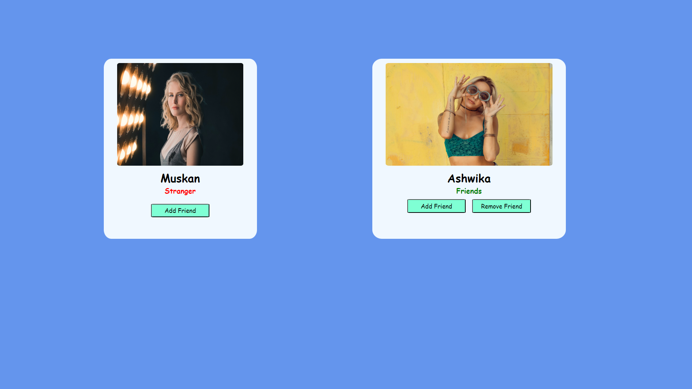

# Add / Remove Friend Button

Profile cards where one button switches between "Add Friend" and "Remove Friend".

## Features

- Single button that changes its text, colour and the profile status
- Written with querySelector and event listeners

## Run it

No build step. Open `index.html` in a browser, or serve the folder with any static server, for example `python -m http.server`.

## Screenshots

